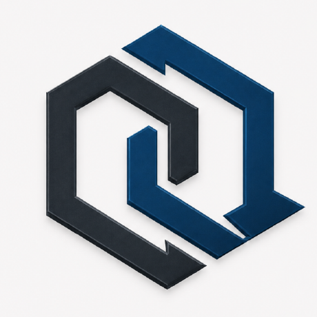

<div align="center">
  
  <h1>Deadlock — Portal</h1>
  <p>Portal de entrada da equipe Deadlock · Projetos, pessoas e código</p>
  <p><strong>Engenharia de Software · Univates · 2026B</strong></p>
</div>

---

## Propósito

O **Deadlock Portal** é a landing page da equipe responsável pelo projeto acadêmico TechPro. Centraliza o acesso aos dois repositórios e ao website publicado, apresenta os quatro integrantes e documenta nossa forma de trabalhar.

- [TechPro App](https://github.com/univates-deadlock/techpro-app) — sistema de gestão de clientes, orçamentos e serviços.
- [TechPro Institutional Page](https://github.com/univates-deadlock/techpro-institutional-page) — site institucional da empresa [TechPro](https://techpro.matbdev.com).
- [GitHub Deadlock](https://github.com/univates-deadlock) — organização da equipe.

A landing page é **100% estática**: HTML sem framework, CSS e JavaScript puro; sem dependências npm, backend, banco de dados ou etapa de build. As prévias mostram **capturas reais** da tela de login do TechPro App e do site institucional publicado. Clique em cada imagem para ampliá-la.

As capturas abrem uma galeria na própria página, com navegação por botões ou
pelas setas do teclado. Feche com `Esc`, pelo botão de fechar ou clicando fora
da imagem. Sem JavaScript, as imagens continuam abrindo diretamente em outra
aba. Cards, fotos, links e botões têm estados de hover, foco e clique; os
movimentos respeitam a preferência de movimento reduzido do dispositivo.

> **Identidade visual:** `assets/deadlock-logo.png` é a imagem usada pela organização [univates-deadlock no GitHub](https://github.com/univates-deadlock). A mesma logo aparece no cabeçalho, destaque inicial, rodapé, página 404, favicon e imagem de compartilhamento. As fotos da equipe também vêm dos perfis confirmados nos commits. Todas as imagens são servidas localmente, sem consultar a API do GitHub durante a navegação. Veja as [fontes dos assets e como atualizar as capturas](docs/asset-sources.md).

## Estrutura

```text
.
├── index.html                  # Página única do portal
├── 404.html                    # Página de erro para Caddy
├── AGENTS.md                   # Convenções de arquitetura, BEM e fluxo de desenvolvimento
├── CLAUDE.md                   # Instruções para agentes e referência às skills instaladas
├── css/
│   ├── variables.css           # Design tokens (cores, tipografia, espaçamentos e movimento)
│   ├── global.css              # Fonte local, reset, layout base e utilitários globais
│   ├── components/             # Estilos BEM de componentes reutilizáveis e galeria
│   └── pages/                  # Estilos específicos das páginas (home.css e 404.css)
├── js/
│   ├── main.js                 # Menu mobile, ano dinâmico e reveal progressivo
│   └── gallery.js              # Galeria acessível das capturas reais
├── assets/                     # Logo, favicon, capa, fotos da equipe, capturas e fontes
├── docs/asset-sources.md       # Origem das imagens, fontes e atualização das capturas
├── docs/github-topics.json     # Metadados de tópicos do repositório
├── tests/check_site.py         # Validação de referências locais e assets CSS
├── tests/check_interactions.cjs # Verificação opcional no navegador
├── .github/workflows/
│   ├── ci.yml                  # Validação e smoke test do container
│   ├── deploy.yml              # Deploy SSH na VM a partir da main
│   └── notify-deploy.yml       # Notificação para deploy central (deadlock-deploy)
├── Dockerfile                  # Caddy Alpine
├── Caddyfile                   # HTTP interno na porta 8080
└── compose.yaml                # Container, rede e porta local 8081
```

## Rodar localmente

Pré-requisito: Python 3 (ou Docker com Compose).

```bash
git clone https://github.com/univates-deadlock/deadlock-portal.git
cd deadlock-portal
python3 -m http.server 8000 --bind 127.0.0.1
```

Abra **http://127.0.0.1:8000/**. Para encerrar, use `Ctrl+C`.

Com Docker, use:

```bash
docker compose up -d --build
curl -fsS http://127.0.0.1:8081/health
docker compose logs -f web
# para parar: docker compose down
```

A URL local com Docker é **http://127.0.0.1:8081/**. O Caddy dentro do container escuta na porta **8080**, mapeada apenas para o loopback da VM. Não use `8080:8080` no host: a aplicação institucional TechPro já usa a porta 8080; a mesma VM também já utiliza 80/443.

## Validar as interações

A validação básica não precisa de dependências:

```bash
python3 tests/check_site.py
node --check js/main.js
node --check js/gallery.js
```

O teste opcional de navegador usa Playwright como ferramenta de desenvolvimento;
não adiciona dependências à página. Com o portal rodando, execute:

```bash
npm install --prefix /tmp/deadlock-browser-check --no-save playwright
/tmp/deadlock-browser-check/node_modules/.bin/playwright install chromium
PLAYWRIGHT_MODULE=/tmp/deadlock-browser-check/node_modules/playwright node tests/check_interactions.cjs http://127.0.0.1:8081
```

O teste cobre a galeria, navegação por teclado, foco, bloqueio de rolagem,
fechamento por botão/Esc/clique fora, preferência de movimento reduzido,
telas de 320/390/1440 pixels e abertura das capturas sem JavaScript.

## CI/CD — GitHub Actions

Fluxo:

```text
push/PR ──> CI (HTML/links/JS/Compose/Caddy via smoke test)
CI aprovado na main ──┬──> Central CD (notify-deploy.yml via repository dispatch)
                      └──> Deploy direto SSH (deploy.yml com known_hosts) ──> VM
```

O repositório possui duas formas de automação de entrega após o **CI da `main` concluir com sucesso**:

1. **Notificação de CD Central (`notify-deploy.yml`):** Notifica o repositório central [`univates-deadlock/deadlock-deploy`](https://github.com/univates-deadlock/deadlock-deploy) através de repository dispatch (`deploy-main`), utilizando o secret `DEPLOY_DISPATCH_TOKEN`.
2. **Deploy direto SSH (`deploy.yml`):** Conecta diretamente na VM via SSH e executa `git pull` e `docker compose up -d --build --wait` (também aceita acionamento manual por `workflow_dispatch`). Para não bloquear execuções quando os secrets SSH não estiverem definidos, o deploy direto é ignorado de forma segura.

### 1. Preparar o clone na VM (somente uma vez para deploy direto)

Conecte-se à VM por SSH de uma rede permitida e execute **como o mesmo usuário usado por `VM_USER`**:

```bash
cd "$HOME"
git clone https://github.com/univates-deadlock/deadlock-portal.git deadlock-portal
cd deadlock-portal
sudo docker compose up -d --build --wait
curl -fsS http://127.0.0.1:8081/health
```

A conta SSH precisa ter `sudo -n docker ...` autorizado sem prompt de senha, como no workflow institucional original. Nenhuma regra de UFW extra é necessária para a porta 8081, pois o serviço está disponível somente em `127.0.0.1` no host.

### 2. Configurar secrets organizacionais

Configure os seguintes **Actions secrets** na organização `univates-deadlock` (ou explicitamente para o repositório `deadlock-portal`):

| Secret | Workflow | Finalidade / Valor esperado |
| --- | --- | --- |
| `DEPLOY_DISPATCH_TOKEN` | `notify-deploy.yml` | Token com permissão para disparar o repositório central `deadlock-deploy` |
| `VM_HOST` | `deploy.yml` | IP ou DNS que o runner do GitHub consegue acessar por SSH |
| `VM_USER` | `deploy.yml` | Conta Linux do usuário que possui `~/deadlock-portal` |
| `VM_PORT` | `deploy.yml` | Porta externa SSH configurada na VM (padrão 22 se omitido) |
| `VM_SSH_KEY` | `deploy.yml` | Chave **privada** SSH autorizada para `VM_USER` |
| `VM_KNOWN_HOSTS` | `deploy.yml` | Entrada validada do host/porta, incluindo `[host]:porta` quando não for 22 |

### 3. Tornar a página pública com HTTPS sem disputar 80/443

A VM já publica `techpro.matbdev.com` por outro Caddy, que ocupa as portas 80/443. Este portal usa **seu próprio Caddy de aplicação**, mas precisa entrar no **Caddy de borda existente** para receber um domínio HTTPS. O Compose cria uma rede Docker nomeada `deadlock_edge`.

No `compose.yaml` do **projeto institucional**, adicione a rede externa ao serviço `web`, preservando suas redes atuais:

```yaml
services:
  web:
    networks:
      - default
      - deadlock_edge

networks:
  deadlock_edge:
    external: true
```

> Trecho para mesclar, não para substituir o Compose inteiro do site institucional.

No `Caddyfile` do site institucional (Caddy de borda), adicione outro bloco além de `techpro.matbdev.com`:

```caddyfile
# Substituir por domínio real, depois de configurar o DNS apontando para a VM.
portal.example.com {
    reverse_proxy deadlock-portal:8080
}
```

Por fim, aplique as alterações do site institucional com `docker compose up -d --build` naquele projeto. **Não adicione novas publicações de porta 80/443 ao portal.** O HTTPS e os certificados ficam a cargo do Caddy de borda. A migração do domínio exige DNS, validação da acessibilidade 80/443 e escolha de nome pela equipe — não ocorre apenas pela configuração deste repositório.

### 4. Operação e diagnóstico

```bash
cd ~/deadlock-portal
sudo docker compose ps
sudo docker compose logs --tail=100 web
curl -i http://127.0.0.1:8081/health
sudo docker compose up -d --build --wait
```

Se o deploy falhar, consulte **Actions → CD — Deploy Deadlock Portal**, confirme que o repositório está clonado em `~/deadlock-portal`, que `git pull` funciona no usuário SSH e que os secrets organizacionais estão habilitados para o repositório.

## Equipe

- [Alexandra Padilha](https://github.com/alexandrapadilha1) — frontend e site institucional.
- [Diogo Felipe Zanco](https://github.com/DiogoFZanco) — frontend.
- [Mateus Carniel Brambilla](https://github.com/matbdev) — DevOps, backend e infraestrutura.
- [Tainá Luiza Schmidt](https://github.com/TainaSchmidt) — backend.

As atribuições refletem o escopo do projeto acadêmico, não cargos profissionais.

## Metadados do GitHub

**Descrição:** Portal da equipe Deadlock — projetos, integrantes e desenvolvimento de software na Univates.

**Topics:** `deadlock`, `portfolio`, `landing-page`, `html`, `css`, `javascript`, `caddy`, `docker`, `github-actions`, `devops`, `univates`, `techpro` (definidos também em [`docs/github-topics.json`](docs/github-topics.json))

**Homepage:** preencher depois de configurar o DNS e o HTTPS.

## Licença e identidade

Código disponibilizado para fins de demonstração acadêmica. Sem arquivo de licença, todos os direitos permanecem com seus respectivos autores; adicione uma licença explícita com aprovação da equipe antes de conceder direitos de reutilização irrestrita.
